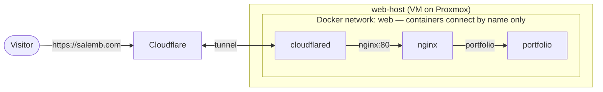

# homelab

My home server: an HP EliteDesk mini PC running Proxmox.

## Overview

1. A visitor opens `https://salemb.com`. Cloudflare answers and gives HTTPS.
2. Cloudflare sends the request through the tunnel to `cloudflared`.
3. `cloudflared` sends it to `nginx`, and `nginx` sends it to `portfolio`.
4. The page goes back the same way.

No ports are open on the router: `cloudflared` opens the tunnel from home.

## Docs

- [Plan](PLAN.md): what is done and what is next
- [Hardware](docs/hardware.md): my machine
- [Proxmox](docs/proxmox.md): the base system and my VMs
- [Docker](docs/docker.md): Docker on my web server VM
- [Nginx](docs/nginx.md): reverse proxy and domains
- [Cloudflare Tunnel](docs/cloudflare-tunnel.md): how the internet reaches my server
- [Cheatsheet](docs/cheatsheet.md): health checks
- [Incidents](docs/incidents): problems I encountered
- [Labs](labs): labs I built and deleted
